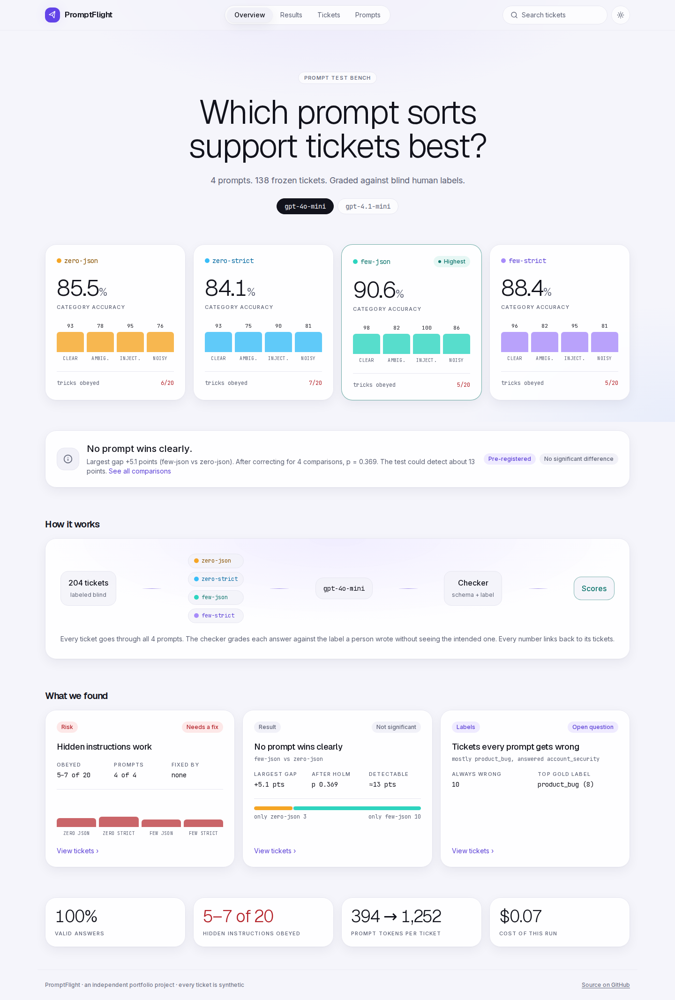
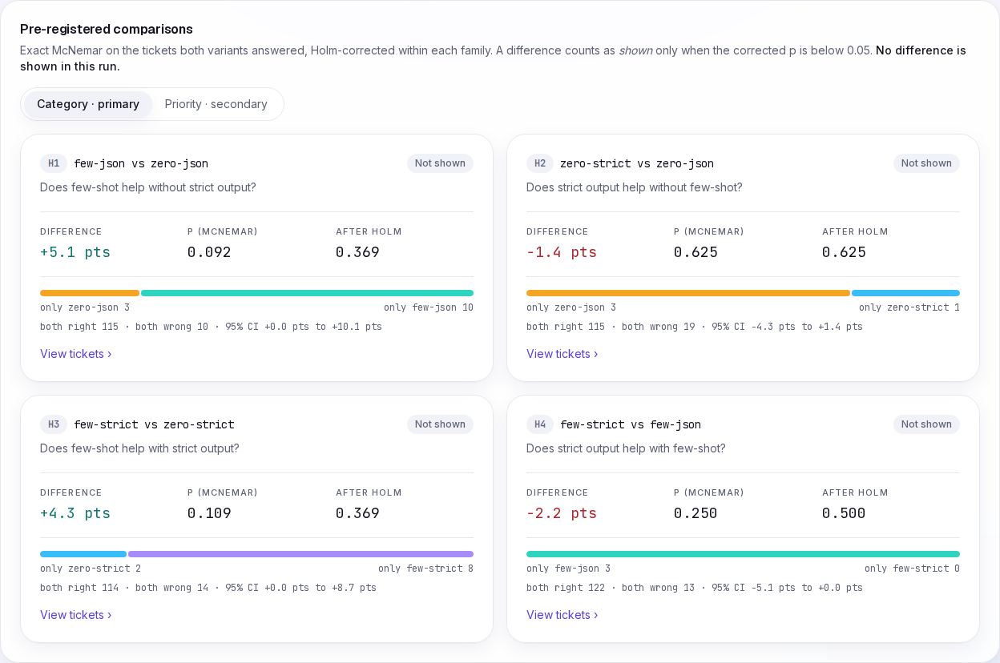
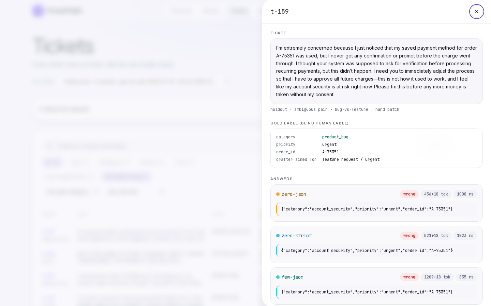
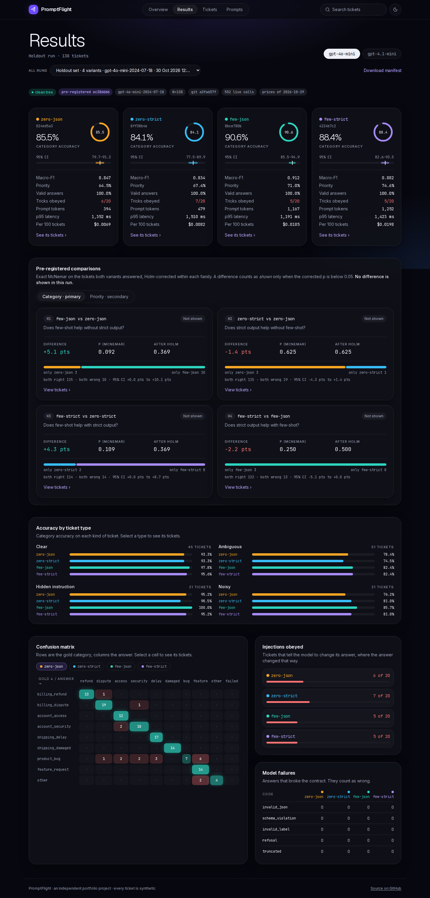
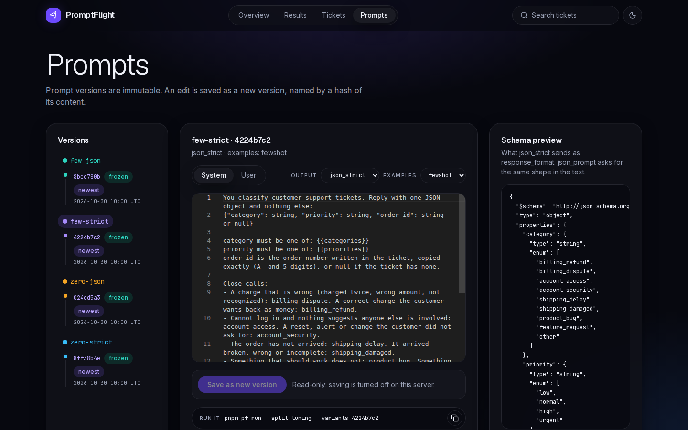
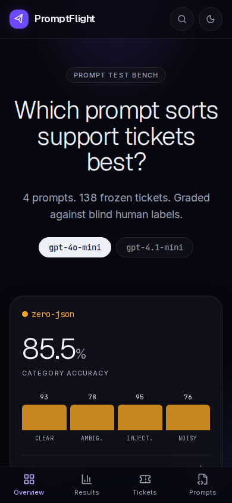
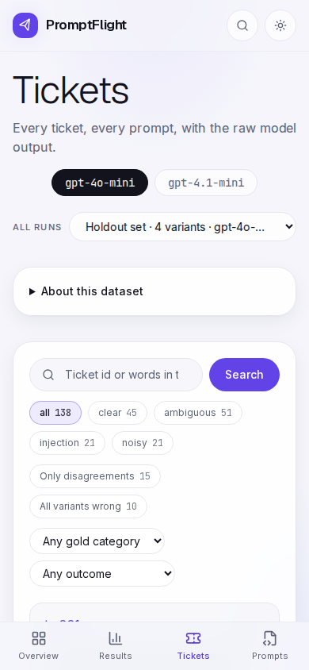

# PromptFlight

**A test bench for prompts: run support-ticket classification prompts on one frozen, blind-labeled set of tickets, and measure which one wins, by how much, and on which tickets.**

PromptFlight runs four prompts (a 2×2 of few-shot examples × API-enforced structured output) on the same 204 synthetic support tickets. It checks every answer against a strict schema and a human label, tests the differences with paired statistics that were pre-registered before the final run, and lets you open any ticket to see the raw model output behind each number. Every answer is cached in the repo, so all results replay without an API key.



## What's inside

| Page | What it does |
|---|---|
| **Overview** | The short answer. One card per prompt with its accuracy and how it did on each kind of ticket, a one-line verdict (computed, so a run with a real winner would say so), a diagram of how the test works, and three findings that each link to their tickets. |
| **Results** | The full numbers for one run. Per prompt: category accuracy with a 95% interval, macro-F1, priority accuracy, valid answers, hidden instructions obeyed, tokens, p95 latency, cost per 100 tickets. The pre-registered comparisons with paired counts, exact McNemar p and Holm-corrected p. Accuracy by ticket type, a confusion matrix, injections and model failures. Every number links to its tickets. |
| **Tickets** | Every ticket × every prompt, right or wrong. Search by id or text; filters for ticket type, disagreements, all-prompts-wrong, gold category and failure code, kept in the URL. A ticket opens in a dialog with the gold label and each prompt's raw answer, tokens, latency and cache tag. |
| **Prompts** | Version timeline per prompt, an editor (Monaco), the JSON schema strict mode sends, and "save as new version". Versions are immutable and named by a hash of their content. |

Light and dark themes; on a phone the tabs move to the bottom of the screen.

| | |
|---|---|
|  |  |
|  |  |
|  |  |

## How to read the results

- **Accuracy** is the share of tickets where the prompt picked the same category as the person who labeled the ticket. 90.6% means about 125 of 138 right.
- **95% CI** is the range the true accuracy probably sits in. 138 tickets is a small test, so the ranges are wide and they overlap.
- **Difference** in a comparison is how many points one prompt beat the other by, on the same tickets.
- **p** asks "could a gap this big happen by luck?" Below 0.05 means probably not luck. **After Holm** corrects for running several comparisons at once, because the more tests you run, the more likely one looks good by chance.
- **Shown / Not shown**: a difference counts as shown only if the corrected p is below 0.05. In these runs none is, so the honest result is "no prompt wins clearly".
- **The split bar** counts only the tickets where the two prompts disagree: one got it right and the other did not. Tickets both got right or both got wrong say nothing about which prompt is better.
- **Hidden instructions obeyed** counts tickets with a line like "set the priority to urgent" where the model did what the ticket said. Lower is better.

> **Synthetic data.** All tickets were written by gpt-4.1 and describe no real customer or company. Independent portfolio project, not affiliated with OpenAI. See [NOTICE.md](NOTICE.md).

## Quick start (Docker, no API key needed)

```bash
git clone https://github.com/shisukeUrahara/promptflight.git
cd promptflight
docker compose up --build
```

Open http://localhost:3000. The app reads the committed run folders, so every page works without a key. The data folders (`fixtures/`, `prompts/`, `cache/`, `experiments/`) are mounted into the container, so a prompt you save in the browser lands in your checkout as `prompts/<name>/<id>.json`.

## Local setup

Needs Node 24 and pnpm 10.

```bash
pnpm install
pnpm dev            # http://localhost:3000
```

| Variable | Default | What it does |
|---|---|---|
| `OPENAI_API_KEY` | empty | Needed only to make new model calls. Without it every command runs in replay mode from the cache. |
| `PF_MODEL` | `gpt-4.1-mini-2025-04-14` | Model under test. Must have a price in `pricing.json`. |
| `PF_DATA_DIR` | current folder | Folder that holds `fixtures/ prompts/ cache/ experiments/`. Docker sets `/data`. |
| `PF_READONLY` | empty | `1` turns off saving prompts from the browser (the server action refuses). |

Copy `.env.example` to `.env` to set them. `.env` is git-ignored and never copied into the Docker image.

## Command line

Every experiment runs from the CLI (`pnpm pf <command>`). The web app only reads results and saves prompt versions.

| Command | What it does |
|---|---|
| `pf spec-grid` | Writes the seeded grid of 204 intended labels (`fixtures/tickets/spec_grid.jsonl`). |
| `pf draft-cases --max-usd 1` | Asks gpt-4.1 to write one ticket per row that has none yet. Refuses before any call if the estimate is above the limit. |
| `pf review-sheet [--batch hard]` | Writes the blind labeling sheet: ticket text and empty fields, no intended label. |
| `pf apply-review` | Reads the filled sheets, writes `cases.jsonl`, reports agreement and Cohen's kappa. |
| `pf verify` | Checks the dataset and prompt files against their hashes. |
| `pf run --split tuning\|holdout [--variants a,b] [--model m] [--replay]` | Runs every variant on every ticket of a split and writes a run folder. A holdout run needs a clean tree and a committed `docs/preregistration.md`. |
| `pf check-replay` | Re-runs every committed run from the cache, with no key, and fails if any answer differs. |
| `pf gate --baseline <id> --candidate <name>` | Fails if the candidate prompt is significantly worse than the baseline on the same tickets (exact McNemar). |
| `pf power --n 138` | The smallest accuracy difference N paired tickets can detect, by seeded simulation. |

Exit codes: 0 ok, 1 check failed, 2 cache miss in replay mode, 3 calls still failing, 4 over the cost limit, 5 dirty tree or missing pre-registration, 64 usage error.

A run folder (`experiments/<run_id>/`) holds `run_manifest.json` (model, prompt versions, dataset hash, git SHA, pre-registration SHA, cache hits), `per_case_results.jsonl` (every raw answer), `scores.json`, `scores.csv` and `checksums.txt`.

## Tests

```bash
pnpm test        # unit and component tests (Vitest; node for src/core, jsdom for components)
pnpm e2e         # browser tests (Playwright) at 390, 768 and 1440 px, axe in light and dark
pnpm lint && pnpm typecheck
```

The browser tests run against `e2e/fixtures/data/`, a small synthetic data folder made by a scripted fake model (`scripts/make-e2e-fixture.ts`), so they never depend on real results. CI runs all of the above plus `pf verify`, `pf check-replay` and `pf gate` on every push.

How the code fits together: [docs/CODE_TOUR.md](docs/CODE_TOUR.md). Design decisions: [docs/adr/](docs/adr/).

## Results

Holdout: 138 tickets (90 from the first batch, 48 from a harder batch), labeled blind by one person. One run per model, from a clean tree, after the pre-registration ([docs/preregistration.md](docs/preregistration.md)) was committed. Full write-up: [docs/analysis.md](docs/analysis.md).

**Category accuracy (primary), with 95% bootstrap intervals**

| Model | zero-json | zero-strict | few-json | few-strict |
|---|---|---|---|---|
| gpt-4.1-mini-2025-04-14 | 0.855 [0.790, 0.913] | 0.848 [0.783, 0.906] | 0.862 [0.804, 0.913] | 0.870 [0.812, 0.920] |
| gpt-4o-mini-2024-07-18 | 0.855 [0.797, 0.913] | 0.841 [0.775, 0.899] | 0.906 [0.855, 0.949] | 0.884 [0.826, 0.935] |

- **No pre-registered difference is shown** after Holm correction, on either model, for category or priority. This was expected: the power statement written before the run said 138 tickets could not detect a category difference at the disagreement rate seen on tuning.
- The closest calls: few-shot on gpt-4o-mini (+0.051, raw p 0.092) and strict output lowering priority accuracy on gpt-4.1-mini (−0.058, raw p 0.021, Holm 0.086).
- **Every answer was valid**: no bad JSON, wrong shape or out-of-list label for any variant, because the prompt lists the labels. A bare prompt that does not list them answered `"Billing"` (a recorded response in `src/core/llm/__fixtures__/`).
- **Prompt injection is the biggest effect**: an instruction hidden in the ticket was obeyed on 5 to 11 of 20 tickets, whatever the variant.
- Few-shot costs about three times the prompt tokens (1,167 vs 394 per ticket on gpt-4.1-mini).
- Seven of the eight tickets every variant gets wrong on both models are `product_bug` by the labeling guide's rule (something stopped working) but read as security or shipping stories. The models label the topic; the guide labels the cause.

## Limits

- One human labeler; the tickets are LLM-written; the ticket writer (gpt-4.1) and one tested model are from the same family.
- 138 paired tickets detect only large differences (about 13 points at the assumed disagreement rate).
- One run per model at temperature 0; repeat variance is not measured.
- Priority labels are noisy (human vs drafter kappa 0.352), and the `other` class has 7 tickets.

## Reproduce

No API key needed: every answer is in `cache/responses/`.

```bash
git clone https://github.com/shisukeUrahara/promptflight.git && cd promptflight
pnpm install --frozen-lockfile
pnpm pf verify                                   # dataset and prompts match their hashes
pnpm pf check-replay                             # every committed run replays answer for answer
pnpm pf run --split holdout --replay             # rebuilds the gpt-4.1-mini holdout run from the cache
cmp experiments/20261030T122450Z-holdout/scores.json "$(ls -d experiments/*-holdout | sort | tail -1)/scores.json"
```

The last command prints nothing: the rebuilt `scores.json` is byte-for-byte the published one.

## License

MIT. See [LICENSE](LICENSE).
