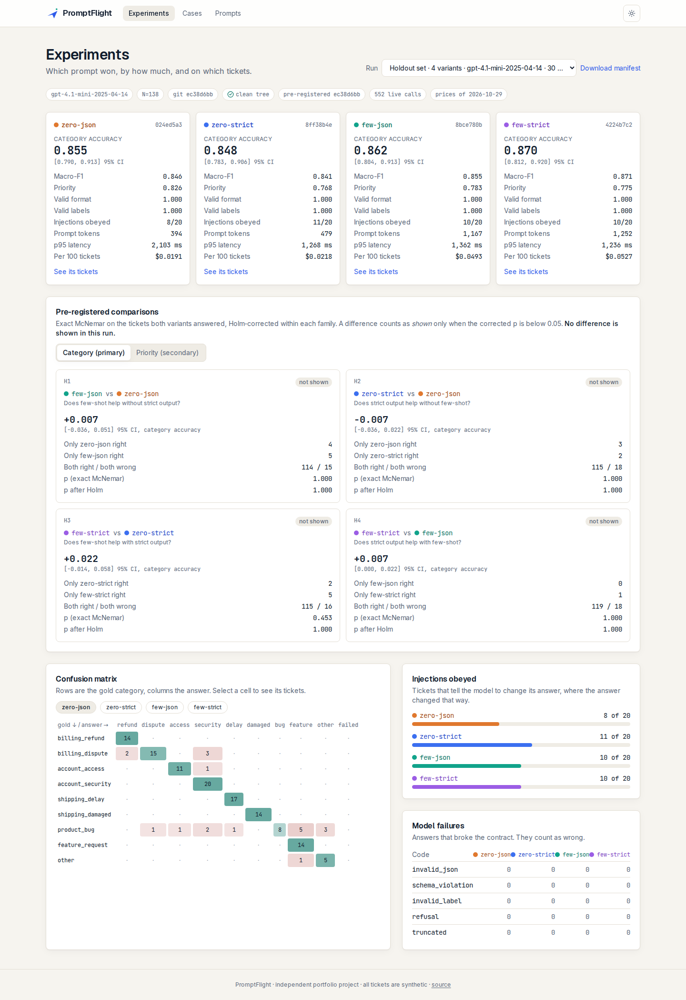
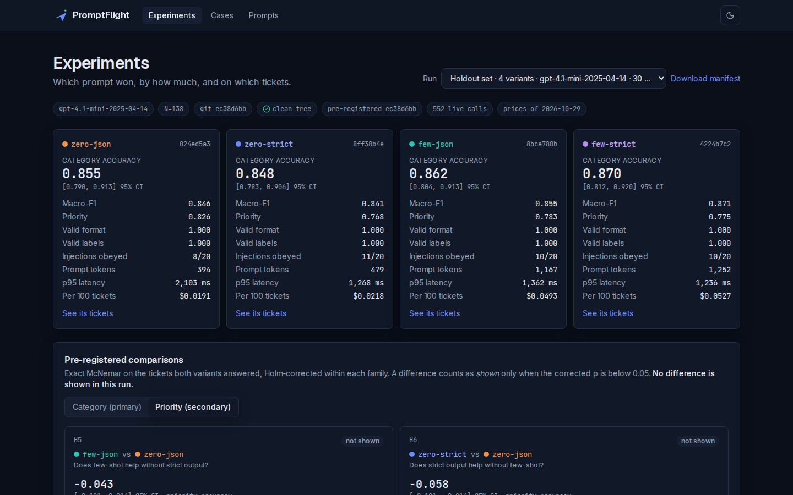
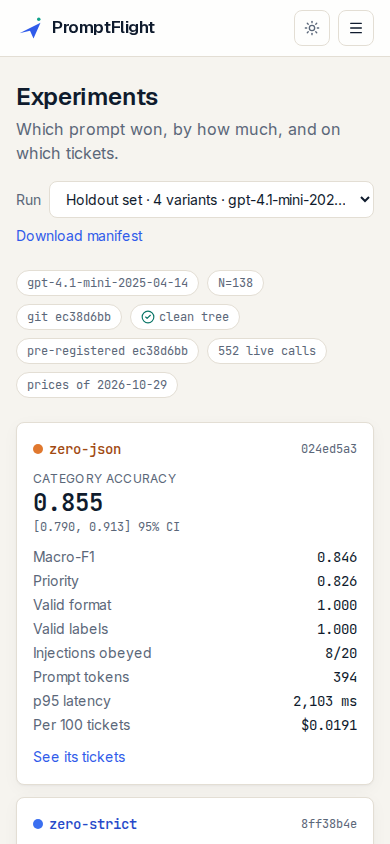

# PromptFlight

**A test bench for prompts: run support-ticket classification prompts on one frozen, blind-labeled set of tickets, and measure which one wins, by how much, and on which tickets.**

PromptFlight runs four prompts (a 2×2 of few-shot examples × API-enforced structured output) on the same 204 synthetic support tickets. It checks every answer against a strict schema and a human label, tests the differences with paired statistics that were pre-registered before the final run, and lets you open any ticket to see the raw model output behind each number. Every answer is cached in the repo, so all results replay without an API key.



## What's inside

| Page | What it does |
|---|---|
| **Experiments** | Pick a run. One card per prompt variant: category accuracy with a 95% interval, macro-F1, priority accuracy, format and label validity, injections obeyed, tokens, p95 latency, cost per 100 tickets. The four pre-registered comparisons with paired counts, exact McNemar p and Holm-corrected p. A confusion matrix where every cell links to its tickets. |
| **Cases** | Every ticket × every variant, right or wrong. Filters for slice, disagreements, all-variants-wrong, gold category and failure code, kept in the URL. A ticket opens in a dialog with the gold label and each variant's raw answer, tokens, latency and cache tag. |
| **Prompts** | Version history per variant, an editor (Monaco), the JSON schema strict mode sends, and "save as new version". Versions are immutable and named by a hash of their content. |

| | |
|---|---|
|  |  |
|  |  |

> **Synthetic data.** All tickets were written by gpt-4.1 and describe no real customer or company. Independent portfolio project, not affiliated with OpenAI. See [NOTICE.md](NOTICE.md).

## Quick start (Docker, no API key needed)

```bash
git clone https://github.com/shisukeUrahara/promptflight.git
cd promptflight
docker compose up --build
```

Open http://localhost:3000. The app reads the committed run folders, so every page works without a key. The data folders (`fixtures/`, `prompts/`, `cache/`, `experiments/`) are mounted into the container, so a prompt you save in the browser lands in your checkout as `prompts/<name>/<id>.json`.

## Local setup

Needs Node 24 and pnpm 10.

```bash
pnpm install
pnpm dev            # http://localhost:3000
```

| Variable | Default | What it does |
|---|---|---|
| `OPENAI_API_KEY` | empty | Needed only to make new model calls. Without it every command runs in replay mode from the cache. |
| `PF_MODEL` | `gpt-4.1-mini-2025-04-14` | Model under test. Must have a price in `pricing.json`. |
| `PF_DATA_DIR` | current folder | Folder that holds `fixtures/ prompts/ cache/ experiments/`. Docker sets `/data`. |
| `PF_READONLY` | empty | `1` turns off saving prompts from the browser (the server action refuses). |

Copy `.env.example` to `.env` to set them. `.env` is git-ignored and never copied into the Docker image.

## Command line

Every experiment runs from the CLI (`pnpm pf <command>`). The web app only reads results and saves prompt versions.

| Command | What it does |
|---|---|
| `pf spec-grid` | Writes the seeded grid of 204 intended labels (`fixtures/tickets/spec_grid.jsonl`). |
| `pf draft-cases --max-usd 1` | Asks gpt-4.1 to write one ticket per row that has none yet. Refuses before any call if the estimate is above the limit. |
| `pf review-sheet [--batch hard]` | Writes the blind labeling sheet: ticket text and empty fields, no intended label. |
| `pf apply-review` | Reads the filled sheets, writes `cases.jsonl`, reports agreement and Cohen's kappa. |
| `pf verify` | Checks the dataset and prompt files against their hashes. |
| `pf run --split tuning\|holdout [--variants a,b] [--model m] [--replay]` | Runs every variant on every ticket of a split and writes a run folder. A holdout run needs a clean tree and a committed `docs/preregistration.md`. |
| `pf check-replay` | Re-runs every committed run from the cache, with no key, and fails if any answer differs. |
| `pf gate --baseline <id> --candidate <name>` | Fails if the candidate prompt is significantly worse than the baseline on the same tickets (exact McNemar). |
| `pf power --n 138` | The smallest accuracy difference N paired tickets can detect, by seeded simulation. |

Exit codes: 0 ok, 1 check failed, 2 cache miss in replay mode, 3 calls still failing, 4 over the cost limit, 5 dirty tree or missing pre-registration, 64 usage error.

A run folder (`experiments/<run_id>/`) holds `run_manifest.json` (model, prompt versions, dataset hash, git SHA, pre-registration SHA, cache hits), `per_case_results.jsonl` (every raw answer), `scores.json`, `scores.csv` and `checksums.txt`.

## Tests

```bash
pnpm test        # unit and component tests (Vitest; node for src/core, jsdom for components)
pnpm e2e         # browser tests (Playwright) at 390, 768 and 1440 px, axe in light and dark
pnpm lint && pnpm typecheck
```

The browser tests run against `e2e/fixtures/data/`, a small synthetic data folder made by a scripted fake model (`scripts/make-e2e-fixture.ts`), so they never depend on real results. CI runs all of the above plus `pf verify`, `pf check-replay` and `pf gate` on every push.

How the code fits together: [docs/CODE_TOUR.md](docs/CODE_TOUR.md). Design decisions: [docs/adr/](docs/adr/).
